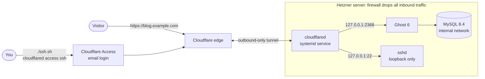

# Ghost on Hetzner, reachable only through a tunnel

`./deploy.sh` deploys a [Ghost](https://ghost.org) blog to a Hetzner Cloud server in one step. The server has **no open inbound ports, SSH included**. Visitors reach the blog, and you reach SSH, only through a [Cloudflare Tunnel](https://developers.cloudflare.com/cloudflare-one/connections/connect-networks/). The tunnel agent on the server dials out to Cloudflare, so nothing ever connects in.



## How "no public SSH" is enforced

Each layer would keep SSH private on its own:

| Layer | What it does |
|---|---|
| Hetzner Cloud Firewall | Attached at creation with **zero inbound rules**, so the provider drops every inbound packet before it reaches the server. `deploy.sh` re-applies the empty rule set on every run, in case someone added rules by hand. |
| ufw on the host | `deny incoming` with no allow rules. |
| sshd | Listens on `127.0.0.1` and `::1` only. Keys only, no passwords, no root login. Ubuntu's `ssh.socket` is disabled, because it would listen on `0.0.0.0:22` whatever `ListenAddress` says. |
| Ghost and MySQL | Ghost is published on `127.0.0.1:2368` only. MySQL isn't published at all. |
| Tunnel and Access | `ssh.<domain>` routes to `ssh://127.0.0.1:22`, behind a Cloudflare Access policy that admits only `ADMIN_EMAIL`. The DNS records point at the tunnel, so the server's IP address is never published. |

## Prerequisites

- **Hetzner Cloud:** a project and an API token with read and write access (Console > Security > API tokens).
- **Cloudflare:**
  - A domain (zone) on your account. The free plan is fine.
  - Zero Trust enabled. The free plan is fine; the first time, you pick a team name in the dashboard.
  - An API token with these permissions:
    - Account > Cloudflare Tunnel: Edit
    - Account > Access: Apps and Policies: Edit
    - Zone > DNS: Edit
    - Zone > Zone: Read
- **Locally:** bash (3.2 or newer, so the macOS default works), `curl`, `jq`, `openssl` and `ssh-keygen`. For SSH you also need [`cloudflared`](https://developers.cloudflare.com/cloudflare-one/connections/connect-networks/downloads/) (`brew install cloudflared`).

## Deploy

```bash
cp .env.example .env    # set HCLOUD_TOKEN, CF_API_TOKEN, CF_ZONE, ADMIN_EMAIL
./deploy.sh
```

What it does, in order (each step finds existing resources by name first, so re-running is safe):

1. Checks that the Hetzner server type exists.
2. Looks up the Cloudflare zone and account.
3. Creates the tunnel. It routes `blog.<domain>` to Ghost, `ssh.<domain>` to sshd, and everything else to a 404.
4. Points proxied CNAME records for both hostnames at the tunnel.
5. Creates an Access application for `ssh.<domain>` that allows only `ADMIN_EMAIL`.
6. Uploads your SSH public key to Hetzner. Because a key is given, Hetzner doesn't email you a root password.
7. Creates the deny-all firewall, then the server, with the firewall attached from its first boot.
8. Waits until the server is running, the tunnel is healthy, and Ghost answers at `https://blog.<domain>`.

On first boot, cloud-init runs [`server/bootstrap.sh`](server/bootstrap.sh):

1. Lock down sshd.
2. Enable ufw.
3. Block the cloud metadata service for Docker containers.
4. Start Ghost and MySQL with Docker Compose.
5. **Create the Ghost owner account.**
6. Start the tunnel.

Steps 5 and 6 are in that order deliberately. Ghost's first-run setup endpoint is unauthenticated, so whoever calls it first becomes the owner. Because the tunnel starts only after the owner exists, the blog is never public without one. If Ghost fails to start or the setup fails, the script stops Ghost and still starts the tunnel, so you can SSH in and debug.

The script prints the owner's email and generated password, and saves them to `.state/<server>-credentials.txt` (mode 600). Change the password after your first login.

## SSH

```bash
./ssh.sh                 # opens a browser for the Cloudflare Access login, then a shell as $SSH_USER
./ssh.sh sudo docker ps  # run a single command
```

You can also use plain `ssh` with this in `~/.ssh/config`:

```
Host ssh.example.com
  User admin
  ProxyCommand cloudflared access ssh --hostname %h
```

## Destroy

```bash
./destroy.sh        # asks you to type the server name; --yes skips the prompt
```

This deletes the server (including all blog data), the firewall, the SSH key it uploaded, the DNS records (only those marked `Managed by ghost-deploy`), the Access application and the tunnel.

## Configuration

Everything is set in `.env`. See [`.env.example`](.env.example) for the optional settings: hostnames, server type and location, SSH user and key, blog title, SMTP for staff invites and password resets, and timeouts.

Re-running `deploy.sh` updates the tunnel routes, DNS records, Access policy and firewall. It doesn't rebuild an existing server, because cloud-init runs only on first boot. To rebuild, run `./destroy.sh && ./deploy.sh`.

## Security notes and trade-offs

- **Secrets are generated per deploy** with `openssl rand`: the MySQL passwords and the Ghost owner password. They are never written into the repository.
  - API tokens are passed to curl through 0600 header files.
  - Request bodies go in on stdin.
  - Either way, none of it shows up in `ps` output.
- **The tunnel token and the owner password travel in the cloud-init user data.** That's standard practice, but it means anyone with access to the Hetzner project can read them. Two measures limit the exposure:
  - Containers are blocked from the metadata service (`169.254.169.254`), so a compromised Ghost container can't read the user data.
  - `bootstrap.env` is shredded after the first boot.
- **The tunnel token is kept out of the unit file.** It lives in a root-only `EnvironmentFile`, not the world-readable unit that `cloudflared service install` would write.
- **Updates:** security updates install automatically (`unattended-upgrades`). Ghost and MySQL are pinned to their major versions (`ghost:6-alpine`, `mysql:8.4`).
- **Why bash and not Terraform:** a one-click script with only `curl` and `jq` as dependencies is easier to run for this task. For a team, Terraform with the `hcloud` and `cloudflare` providers would add a plan step and shared state.

Before relying on this, do one real deploy and check that `ssh.<domain>` asks for an Access login and that `nc -vz <server-ip> 22` times out.

## Next steps

- **Backups:** turn on Hetzner backups, or run a nightly `mysqldump` plus a tarball of the content volume to object storage.
- **Lock down the admin UI:** put `/ghost/` behind Cloudflare Access too. Leave `/ghost/api/content/` public, because themes and search use it.
- **Least privilege for the tunnel agent:** run `cloudflared` under a dedicated user.
